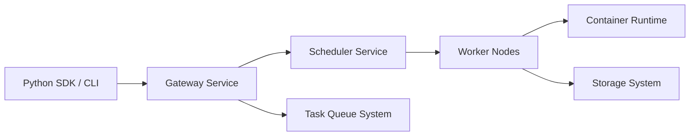

# beam-cloud/beta9

> Open source runtime for deploying serverless AI workloads in Python, with GPU and scale-to-zero.

## The problem
Deploying a model or background tasks with autoscaling and GPU requires setting up the infrastructure yourself.

## What it actually does
A Python SDK (`endpoint`, `task_queue`, `Sandbox` decorators) sends the code to a gateway; a scheduler places containers on workers through a homegrown runtime. Announced features: sub-second starts, distributed volumes, webhooks, scheduled jobs. Beta9 is the open source engine of Beam, the managed cloud; self-hosting is possible.

## How it is wired


## Trying it
```bash
pip install beam-client
```
```python
from beam import Image, Sandbox
sandbox = Sandbox(image=Image()).create()
response = sandbox.process.run_code("print('I am running remotely')")
print(response.result)
```

## Cost and gotchas
Beam cloud: account to create, GPUs billed by usage (no price grid provided). Self-hosting: the README does not detail the installation. AGPL-3.0 license.

## What it is not
Not a simple pip package: the client talks to a backend (cloud or your own). The AGPL imposes obligations if you offer the service to third parties.

## Alternatives
- Celery: which `task_queue` claims to replace for background tasks.

## For you
Worth watching: useful for deploying inference endpoints without managing Kubernetes, but self-hosting is not documented here and the AGPL weighs on commercial use.
