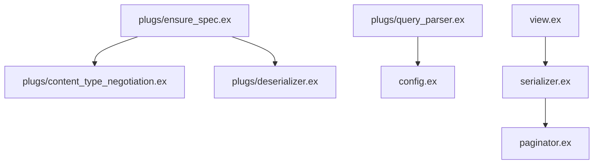

# beam-community/jsonapi

> Elixir library to produce JSON:API documents and validate requests, mainly with Phoenix.

## The problem
Complying by hand with the JSON:API specification (fields, relationships, sorting, filters, pagination) in a Phoenix API is slow and error-prone.

## What it actually does
A view (`JSONAPI.View`) declares fields and relationships; the serializer produces the document. On the request side, plugs check the headers, parse `sort`, `filter` and `include`, and flatten the body. Pagination is a callback or a module you must provide.

## How it is wired


## Trying it
```bash
# mix.exs : ajouter {:jsonapi, "~> 1.10.0"} dans deps, puis
mix deps.get
```

## Cost and gotchas
Free, but you need Elixir. Pagination itself remains to be written: the library only generates the links.

## What it is not
Not a full API framework nor a client: it makes no requests and does no database access.

## Alternatives
No alternative named in the README.

## For you
Ignore: useful only if you build APIs in Elixir/Phoenix, which falls outside a data/AI/MLOps profile.
