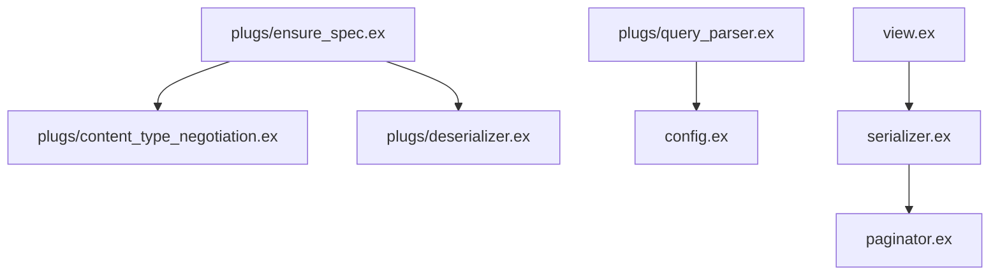

# beam-community/jsonapi

> Bibliothèque Elixir pour produire des documents JSON:API et valider les requêtes, surtout avec Phoenix.

## Le problème
Respecter la spécification JSON:API (champs, relations, tri, filtres, pagination) à la main dans une API Phoenix est long et source d'erreurs.

## Ce que ça fait vraiment
Une vue (`JSONAPI.View`) déclare champs et relations ; le sérialiseur produit le document. Côté requête, des plugs vérifient les en-têtes, analysent `sort`, `filter` et `include`, et aplatissent le corps. La pagination est un callback ou un module à fournir.

## Comment c'est branché


## Essayer
```bash
# mix.exs : ajouter {:jsonapi, "~> 1.10.0"} dans deps, puis
mix deps.get
```

## Coût et pièges
Gratuit, mais il faut Elixir. La pagination elle-même reste à écrire : la bibliothèque ne génère que les liens.

## Ce que ce n'est pas
Pas un framework d'API complet ni un client : il ne fait ni requêtes ni accès base de données.

## Alternatives
Aucune alternative nommée dans le README.

## Pour toi
À ignorer : utile seulement si tu bâtis des API en Elixir/Phoenix, ce qui sort d'un profil data/IA/MLOps.

