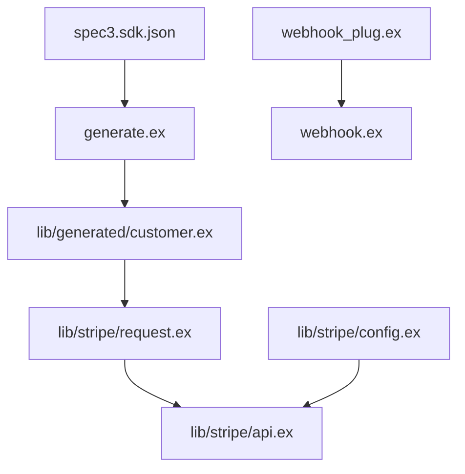

# beam-community/stripity-stripe

> Elixir library to call the Stripe API, intended for Elixir payment applications.

## The problem
Calling the Stripe API from Elixir without writing the requests and structures by hand.

## What it actually does
The modules (such as `lib/generated/customer.ex`) are generated from the OpenAPI specification `spec3.sdk.json` by the `generate.ex` task. At runtime, `request.ex` builds the call that `api.ex` sends with the key from `config.ex`. A plug (`webhook_plug.ex`) verifies incoming events. Handles retries, timeouts and object expansion.

## How it is wired


## Trying it
```elixir
{:stripity_stripe, "~> 3.3"}
config :stripity_stripe, api_key: System.get_env("STRIPE_SECRET")
{:ok, setup_intent} = Stripe.SetupIntent.create(%{})
```

## Cost and gotchas
A Stripe secret key is required; Stripe fees are at your expense. Tests require `stripe-mock`, run with Docker. The README's version table is outdated (2019 API for `master`).

## What it is not
Not a payment product: it is a plain client for the Stripe API.

## Alternatives
No alternative named in the README.

## For you
Ignore: a Stripe client for Elixir, of no interest to a data, AI or MLOps profile.
