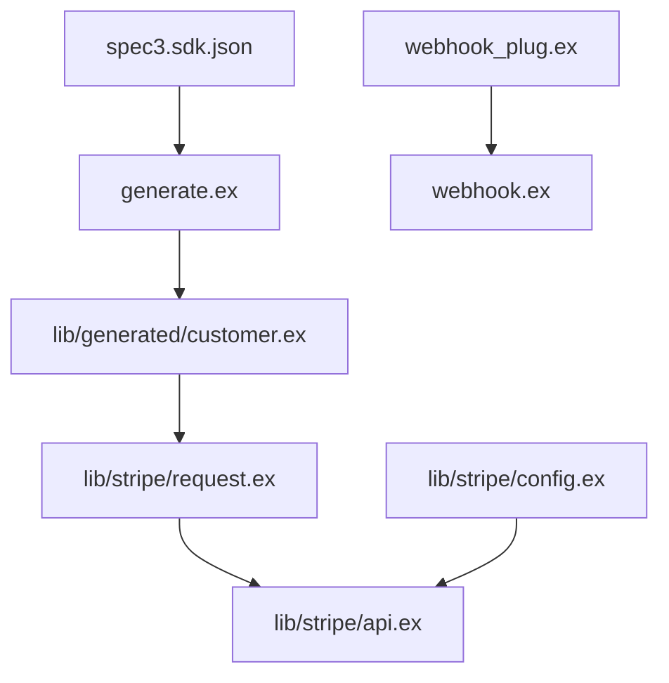

# beam-community/stripity-stripe

> Bibliothèque Elixir pour appeler l'API Stripe, destinée aux applications de paiement Elixir.

## Le problème
Appeler l'API Stripe depuis Elixir sans écrire les requêtes et les structures à la main.

## Ce que ça fait vraiment
Les modules (comme `lib/generated/customer.ex`) sont générés depuis la spécification OpenAPI `spec3.sdk.json` par la tâche `generate.ex`. À l'exécution, `request.ex` construit l'appel que `api.ex` envoie avec la clé de `config.ex`. Un plug (`webhook_plug.ex`) vérifie les événements entrants. Gère retries, timeouts et expansion d'objets.

## Comment c'est branché


## Essayer
```elixir
{:stripity_stripe, "~> 3.3"}
config :stripity_stripe, api_key: System.get_env("STRIPE_SECRET")
{:ok, setup_intent} = Stripe.SetupIntent.create(%{})
```

## Coût et pièges
Clé secrète Stripe requise ; les frais Stripe sont à ta charge. Les tests demandent `stripe-mock`, lancé avec Docker. Le tableau de versions du README est daté (API 2019 pour `master`).

## Ce que ce n'est pas
Pas un produit de paiement : c'est un simple client de l'API Stripe.

## Alternatives
Aucune alternative nommée dans le README.

## Pour toi
À ignorer : client Stripe pour Elixir, sans intérêt pour un profil data, IA ou MLOps.

