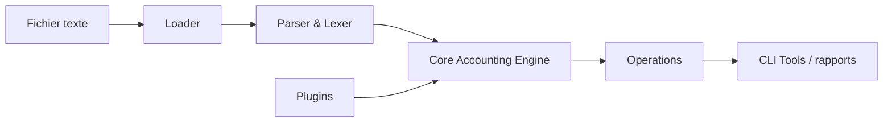

# beancount/beancount

> A double-entry accounting language based on text files, with reports, for technical individuals.

## The problem
Opaque accounting software locks in your data; a text journal stays readable and versionable.

## What it actually does
You write transactions in a text file; the loader parses them (lexer/parser with parts in C), applies the double-entry rules and validation plugins, then operations produce balances and reports. Version 3 (stable since June 2024) is slimmed down: most tools live in separate projects. The documentation is external.

## How it is wired

## Trying it
No documented command: the README points to the installation page of the documentation.

## Cost and gotchas
Free, GPL-2.0 only. Install version 3 (branch v3); versions 1 and 2 are best avoided. The v2 tools (including the web interface) have moved elsewhere.

## What it is not
Not graphical software nor a bank connector.

## Alternatives
- Ledger: a neighbouring mailing list cited for command-line accounting.

## For you
Worth watching: a text format easy to analyze in Python/pandas for personal finance; a project carried by one person.
