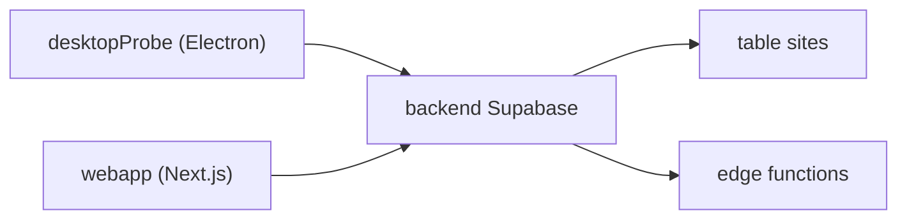

# beastx-ro/first2apply

> Job listing aggregator that centralizes LinkedIn, Indeed, Dice and other platforms for job seekers.

## The problem
Tracking job listings spread across several platforms takes time.

## What it actually does
Nx monorepo: an Electron desktop application ("desktopProbe"), a Next.js web application, a Supabase backend (migrations and edge functions), a showcase site, a blog and Node services. The README mostly describes the development setup and package publishing, not how the collection works.

## How it is wired
Simplified diagram based on the sheet, no diagram provided.



## Trying it
```bash
pnpm install
cd apps/backend
pnpm supabase start
pnpm supabase functions serve
pnpm nx start first2apply-desktop
```

## Cost and gotchas
Node 20+, pnpm 10+, Supabase CLI and Docker for the local Supabase. You must import the `sites_rows.csv` file by hand. The Linux release requires a manual upload to S3.

## What it is not
Not a data science tool. The README documents neither the scrapers nor the terms of use of the targeted platforms.

## Alternatives
No alternative named in the README.

## For you
Ignore: job search tool unrelated to data or AI, and a heavy setup (Supabase, Electron).
