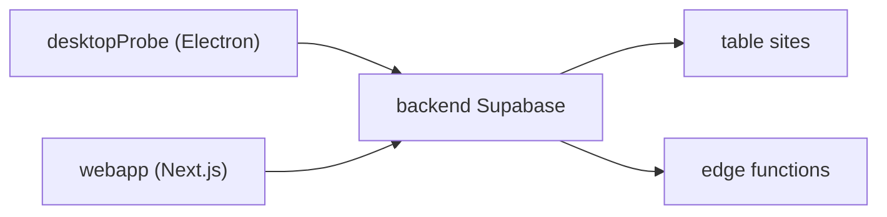

# beastx-ro/first2apply

> Agrégateur d'offres d'emploi qui centralise LinkedIn, Indeed, Dice et d'autres plateformes pour chercheurs d'emploi.

## Le problème
Suivre des offres d'emploi réparties sur plusieurs plateformes prend du temps.

## Ce que ça fait vraiment
Monorepo Nx : une application de bureau Electron (« desktopProbe »), une application web Next.js, un backend Supabase (migrations et fonctions edge), un site vitrine, un blog et des services Node. Le README décrit surtout l'installation de développement et la publication des paquets, pas le fonctionnement de la collecte.

## Comment c'est branché
Schéma simplifié d'après la fiche, sans diagramme fourni.



## Essayer
```bash
pnpm install
cd apps/backend
pnpm supabase start
pnpm supabase functions serve
pnpm nx start first2apply-desktop
```

## Coût et pièges
Node 20+, pnpm 10+, Supabase CLI et Docker pour le Supabase local. Il faut importer à la main le fichier `sites_rows.csv`. La publication Linux demande un envoi manuel vers S3.

## Ce que ce n'est pas
Pas un outil de data science. Le README ne documente ni les scrapers ni les conditions d'usage des plateformes visées.

## Alternatives
Aucune alternative nommée dans le README.

## Pour toi
Ignorer : outil de recherche d'emploi sans lien avec la data ou l'IA, et montage lourd (Supabase, Electron).

