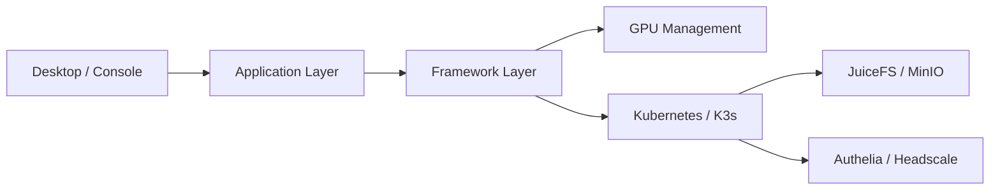

# beclab/Olares

> Personal cloud operating system on Kubernetes, for running agents and LLMs on your own hardware.

## The problem
Hosting AI, files and applications at home without entrusting your data to a third-party cloud.

## What it actually does
Installs a Kubernetes platform with a one-click app marketplace, GPU management (time-slicing, memory-slicing, exclusive mode), storage and backups, private VPN, reverse proxy and system applications (Files, Vault, Market, Dashboard). Access through an Olares ID and the LarePass app. A CLI, `olares-cli`, ships with skills for agents.

## How it is wired


## Trying it
```bash
curl -fsSL https://olares.sh | bash -
```

## Cost and gotchas
Minimum 4 cores, 8 GB of available RAM, 150 GB of SSD (fails on HDD), Ubuntu 22.04–25.04 or Debian 12/13. Olares ID account to create. AGPL-3.0 license. Installer is `curl | bash`.

## What it is not
Not a simple NAS: it is a complete platform, heavier. It is not an ML development tool.

## Alternatives
The README names no alternative, only a comparison with NAS devices.

## For you
Worth watching: interesting for a personal AI lab with a GPU, but you must accept a dedicated machine and a full Kubernetes stack.
