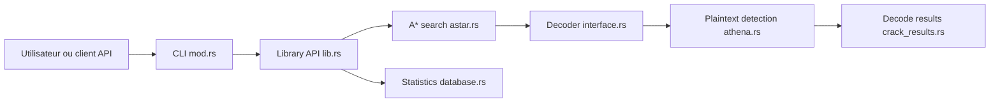

# bee-san/Ciphey

> Rust tool that automatically guesses how to decode an encoded or encrypted text, for CTF and analysis.

## The problem
Faced with an encoded text (Base64, ROT13, Vigenère…), you do not know which chain of decodings to apply. Trying by hand costs time.

## What it actually does
The README presents a Rust rewrite of the old Ciphey. It tests decoders (16 announced) and chains several levels. The search uses A* with a cache and decoder statistics. A plaintext check (n-grams, dictionary, ~500 regexes, optional 500 MB BERT) judges the results. A timer cuts off at 5 s in the CLI.

## How it is wired


## Trying it
```bash
cargo install ciphey
ciphey
git clone https://github.com/bee-san/Ciphey
docker build .
ciphey --enable-enhanced-detection
```

## Cost and gotchas
Free, MIT license. BERT detection requires a one-time 500 MB download and a free Hugging Face account. The speed figures (×7, +700%) are the README's, not verified here.

## What it is not
Not a general cryptanalysis tool: it covers classical encodings and ciphers. The README mentions 16 decoders versus ~50 for the old Ciphey. The TUI is described as entirely "vibe coded".

## Alternatives
- Ciphey (original Python version): more decoders (~50), according to the README.
- PyWhat: identifies the data type; LemmeKnow is its Rust version.

## For you
Worth watching: useful to get out of a jam on a CTF or an encoded text, but marginal for a data / AI / MLOps profile, and the project rests on a single person.
