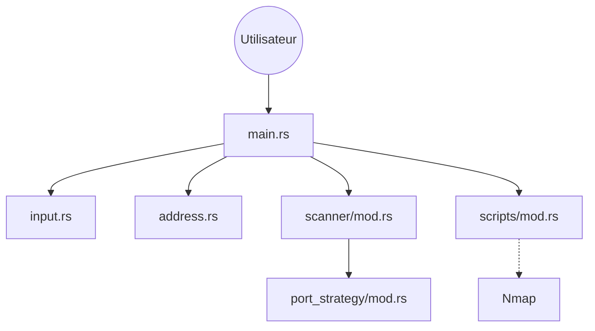

# bee-san/RustScan

> Command-line port scanner written in Rust, for pentesters, that chains into Nmap.

## The problem
Sweeping all 65,000 ports of a target with a classic scanner is slow. You then have to manually relaunch an analysis tool on the open ports.

## What it actually does
It reads targets (IPv6, CIDR, file), resolves them, then probes ports in a configurable order. Open ports are displayed. A script engine (Python, Lua, Shell) can then be triggered, by default with an Nmap command. The README advertises "adaptive learning"; the sampled code does not show its implementation.

## How it is wired


## Trying it
```bash
brew install rustscan
pacman -S rustscan
cargo install rustscan
```

## Cost and gotchas
Free, no key. Only installation via Cargo is officially supported; distribution packages are third-party. Scanning a machine without authorization is a legal risk, not a technical one.

## What it is not
Not a replacement for Nmap: it finds ports and delegates the analysis. The "3 seconds" is a best-case value, not a guarantee. Nothing to do with machine learning: the README says "basic maths".

## Alternatives
- Nmap: the detailed analysis, which RustScan itself calls.

## For you
Watch: useful if your watch touches MLOps infrastructure security (exposure of server ports), with no direct link to data or AI.
