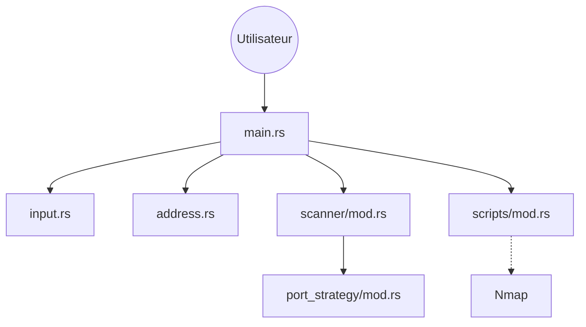

# bee-san/RustScan

> Scanner de ports en ligne de commande écrit en Rust, pour pentesters, qui enchaîne sur Nmap.

## Le problème
Balayer les 65 000 ports d'une cible avec un scanner classique est long. Il faut ensuite relancer à la main un outil d'analyse sur les ports ouverts.

## Ce que ça fait vraiment
Il lit des cibles (IPv6, CIDR, fichier), les résout, puis sonde les ports dans un ordre configurable. Les ports ouverts sont affichés. Un moteur de scripts (Python, Lua, Shell) peut ensuite être déclenché, par défaut avec une commande Nmap. Le README annonce un « apprentissage adaptatif » ; le code échantillonné n'en montre pas l'implémentation.

## Comment c'est branché


## Essayer
```bash
brew install rustscan
pacman -S rustscan
cargo install rustscan
```

## Coût et pièges
Gratuit, sans clé. Seule l'installation par Cargo est officiellement supportée ; les paquets de distributions sont tiers. Scanner une machine sans autorisation est un risque légal, pas technique.

## Ce que ce n'est pas
Ce n'est pas un remplaçant de Nmap : il trouve les ports et délègue l'analyse. Le « 3 secondes » est une valeur au mieux, pas une garantie. Rien à voir avec du machine learning : le README dit « basic maths ».

## Alternatives
- Nmap : l'analyse détaillée, que RustScan appelle lui-même.

## Pour toi
Surveiller : utile si ta veille touche à la sécurité de l'infra MLOps (exposition de ports de serveurs), sans lien direct avec la donnée ou l'IA.

