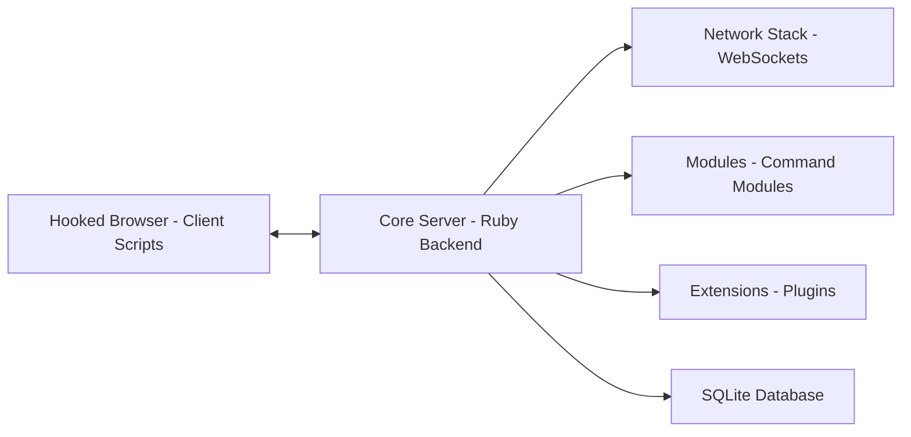

# beefproject/beef

> Security audit framework that assesses the exposure of web browsers, intended for authorized pentesters.

## The problem
Audits focus on the network perimeter and the workstation; the browser, the only open door on the client side, is little tested.

## What it actually does
A Ruby server serves a client script (beef.js) to a "hooked" browser, which keeps a return channel to the server (REST, WebSocket). The server sends command modules sorted by category (browser, host, network...). The collected data is stored in SQLite. Extensions add an administration interface, DNS, a proxy, a Metasploit integration.

## How it is wired


## Trying it
```bash
./install
./beef
```
The README points to the wiki for configuration and hardening before any use.

## Cost and gotchas
Free. Ruby 3.0+, SQLite 3, Node.js 10+; macOS or Linux, Windows not supported. Selenium required on macOS.

## What it is not
A dual-use tool: to be used only on systems for which you have written authorization to audit. The catalog finds no declared license (the README mentions a doc/COPYING file): reuse to be clarified before integration.

## Alternatives
No alternative named in the README.

## For you
Keep an eye on it: useful only if you do authorized web audits; unrelated to everyday data/AI/MLOps work, and the license needs clarifying.
