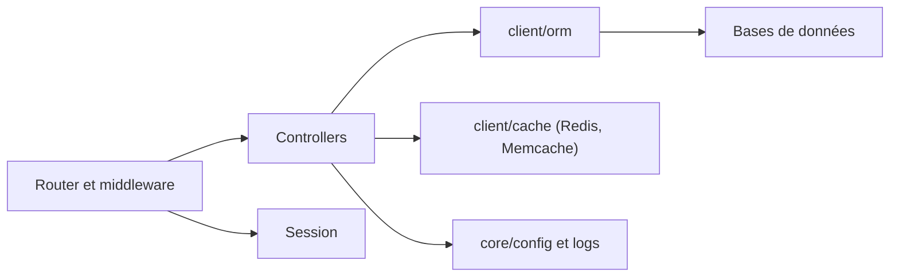

# beego/beego

> Full-stack Go framework for REST APIs, web applications and services, inspired by Tornado, Sinatra and Flask.

## The problem
Assembling a router, an ORM, sessions, caching and configuration in Go means choosing and wiring several libraries.

## What it actually does
Offers an MVC architecture with an annotatable router, namespaces, automatic API documentation and development tools. Modules cover orm, session, logs, config, cache (Redis, Memcache, SSDB, memory), httplib, task, i18n and admin. According to the described architecture: server/web, core and client layers.

## How it is wired


## Trying it
```bash
mkdir hello
cd hello
go mod init
go get github.com/beego/beego/v2@latest
go mod tidy
go build hello.go
./hello
```
The hello.go file contains a simple web.Run().

## Cost and gotchas
Free. The README notes that the documentation site is unavailable (a backup is provided) and that its HTTPS certificate sometimes expires. License not identified by GitHub.

## What it is not
Not a data tool nor a lightweight framework: it bundles many modules. The official documentation is hard to access.

## Alternatives
No alternative mentioned in the README.

## For you
Watch: useful only for a full Go back end, with a license to clarify and fragile docs before any serious use.
