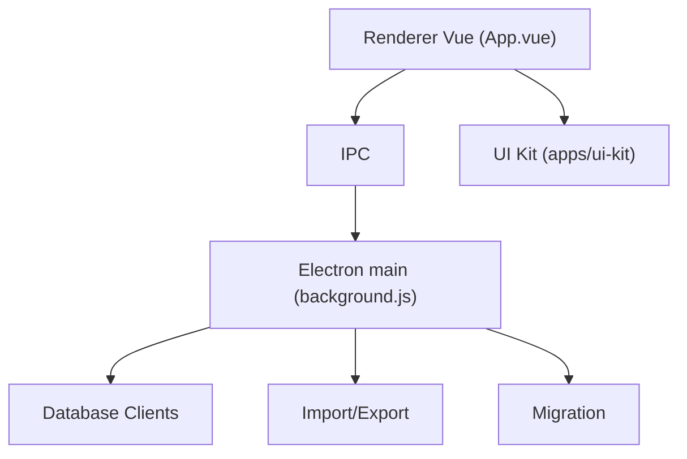

# beekeeper-studio/beekeeper-studio

> Cross-platform SQL editor and database manager, easy to use, with paid options.

## The problem
Open-source SQL clients are often overloaded with features and unpleasant to use.

## What it actually does
Electron/Vue application: SQL editor with autocompletion, tabs, data filtering and sorting, saved queries and history, import/export, backup/restore, JSON view. According to the code, many database clients live in `src-commercial`, with a shared UI Kit.

## How it is wired


## Trying it
```bash
git clone git@github.com:<your-username>/beekeeper-studio.git beekeeper-studio
cd beekeeper-studio/
mise install
pnpm install
pnpm run bks:dev
```

## Cost and gotchas
Free download without an account; premium features under a paid license. License present but not identified by GitHub: to be checked.

## What it is not
Not entirely open: most of it is GPLv3, the paid features are under a commercial source-available license in the same repository.

## Alternatives
No alternative named in the README.

## For you
Worth watching: a good desktop SQL client, but the mix of GPL and commercial license requires checking what your free version covers.
