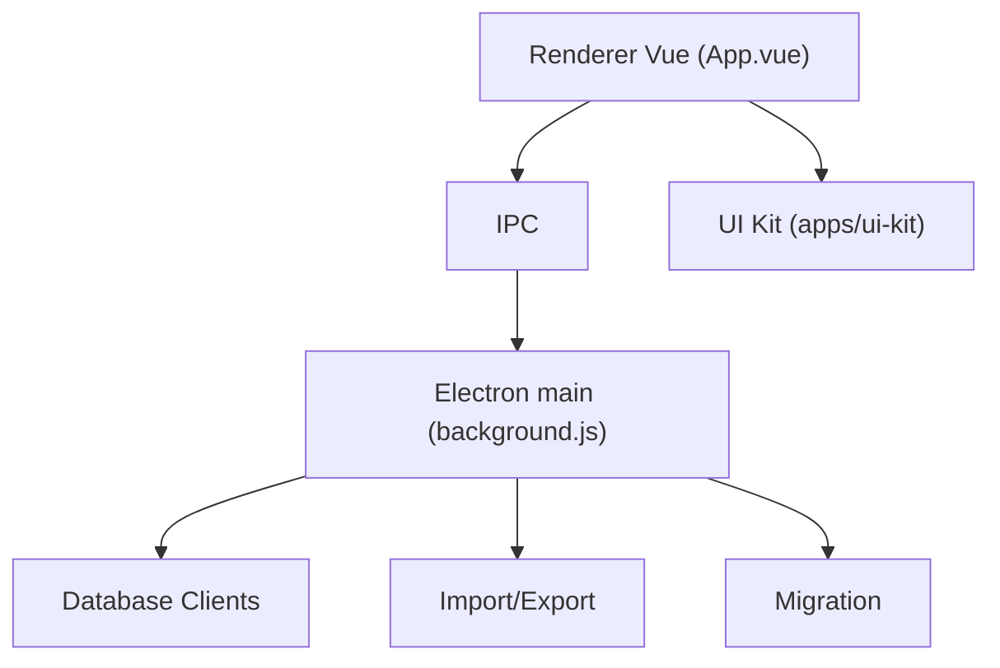

# beekeeper-studio/beekeeper-studio

> Éditeur SQL et gestionnaire de bases de données multiplateforme, simple d'usage, avec options payantes.

## Le problème
Les clients SQL libres sont souvent chargés de fonctions et peu agréables à utiliser.

## Ce que ça fait vraiment
Application Electron/Vue : éditeur SQL avec autocomplétion, onglets, filtre et tri des données, requêtes sauvegardées et historique, import/export, sauvegarde/restauration, vue JSON. D'après le code, de nombreux clients de bases vivent dans `src-commercial`, avec un UI Kit partagé.

## Comment c'est branché


## Essayer
```bash
git clone git@github.com:<your-username>/beekeeper-studio.git beekeeper-studio
cd beekeeper-studio/
mise install
pnpm install
pnpm run bks:dev
```

## Coût et pièges
Téléchargement gratuit sans compte ; fonctions premium sous licence payante. Licence présente mais non identifiée par GitHub : à vérifier.

## Ce que ce n'est pas
Pas entièrement libre : la majorité est en GPLv3, les fonctions payantes sont sous licence commerciale source-available dans le même dépôt.

## Alternatives
Aucune alternative nommée dans le README.

## Pour toi
À surveiller : bon client SQL de bureau, mais le mélange GPL et licence commerciale demande de vérifier ce que ta version gratuite couvre.

