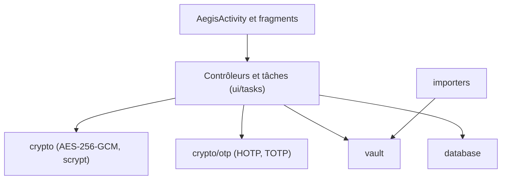

# beemdevelopment/Aegis

> A free Android app for 2FA codes (HOTP/TOTP) with an encrypted vault, for security-minded individuals.

## The problem
Conventional authenticator apps handle encryption and backups poorly: losing your phone means losing access to your accounts.

## What it actually does
Stores 2FA secrets in an encrypted vault (AES-256-GCM), unlocked by password (scrypt) or biometrics. Imports from Google Authenticator, Authy, andOTP and others. Exports in plain or encrypted form, and automatically backs up the vault to the location of your choice.

## How it is wired
Diagram based on the one provided, reduced to the essentials.



## Trying it
```bash
apksigner verify --print-certs --verbose aegis.apk
```
Installation goes through Google Play or F-Droid; the command above is used to verify the APK's signature.

## Cost and gotchas
Free, no account. Android only. Some imports (Authy, for example) require root access. Plain-text backups expose all your secrets.

## What it is not
It is neither a library nor a server tool: it is a personal mobile app. No iOS version, no built-in cloud sync (only backups to a chosen location).

## Alternatives
- andOTP, FreeOTP, 2FAS Authenticator: cited as import sources, hence apps of the same kind.

## For you
Useful personally for your 2FA on Android, but outside the data/AI/MLOps scope: ignore for professional watch.
