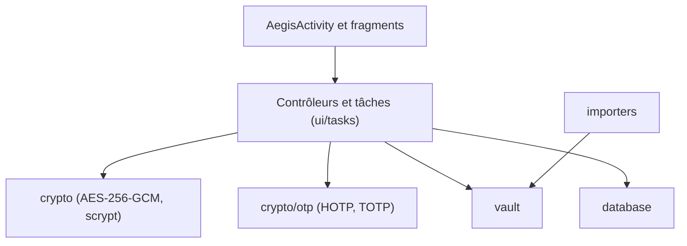

# beemdevelopment/Aegis

> Application Android libre de codes 2FA (HOTP/TOTP) avec coffre chiffré, pour particuliers soucieux de sécurité.

## Le problème
Les applis d'authentification classiques gèrent mal le chiffrement et les sauvegardes : perdre le téléphone, c'est perdre l'accès à ses comptes.

## Ce que ça fait vraiment
Stocke les secrets 2FA dans un coffre chiffré (AES-256-GCM), déverrouillé par mot de passe (scrypt) ou biométrie. Importe depuis Google Authenticator, Authy, andOTP et d'autres. Exporte en clair ou chiffré, et sauvegarde automatiquement le coffre à l'endroit choisi.

## Comment c'est branché
Schéma d'après le diagramme fourni, réduit à l'essentiel.



## Essayer
```bash
apksigner verify --print-certs --verbose aegis.apk
```
L'installation passe par Google Play ou F-Droid ; la commande ci-dessus sert à vérifier la signature de l'APK.

## Coût et pièges
Gratuit, aucun compte. Android uniquement. Certains imports (Authy, par exemple) exigent un accès root. Les sauvegardes en clair exposent tous vos secrets.

## Ce que ce n'est pas
Ce n'est ni une bibliothèque ni un outil pour serveur : c'est une appli mobile personnelle. Pas de version iOS, pas de synchronisation cloud intégrée (seulement des sauvegardes vers un emplacement choisi).

## Alternatives
- andOTP, FreeOTP, 2FAS Authenticator : cités comme sources d'import, donc des applis du même genre.

## Pour toi
Utile à titre personnel pour tes 2FA sur Android, mais hors périmètre data/IA/MLOps : à ignorer pour la veille professionnelle.

