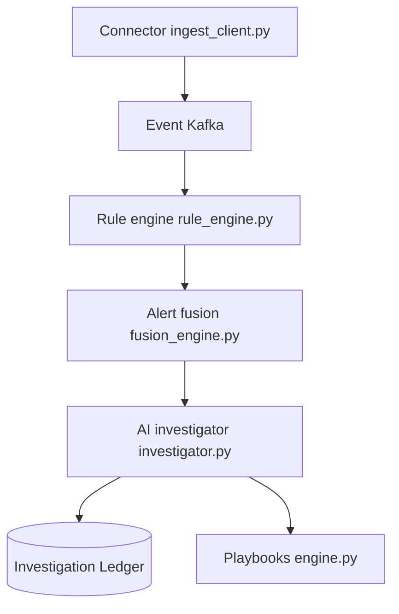

# beenuar/AiSOC

> Self-hosted security SOC: ingests telemetry, detects, has AI agents investigate, a human validates.

## The problem
Security teams drown in alerts and investigate by hand, with no verifiable trace of an AI assistant's reasoning.

## What it actually does
- Normalizes telemetry, passes it through Kafka, applies 2,538 executable rules (out of 7,023 in the library) and groups alerts into incidents.
- An AI agent investigates and records prompts and tool calls in an investigation ledger, exportable as a signed bundle.
- Response actions (playbooks) stay in preview and require human approval.
- 90 connectors; local model llama3.2:3b (~2 GB) provided, no hosted provider tested according to the README.

## How it is wired


## Trying it
```bash
git clone https://github.com/beenuar/AiSOC && cd AiSOC
make up
make smoke
pip install aisoc-sandbox && aisoc-sandbox demo
```

## Cost and gotchas
Docker Compose v2 with 8 GB of RAM and 20 GB of disk; ~2 GB of model on first launch; `full` profile: ~12 GB. The local 3B model is not a state-of-the-art model.

## What it is not
Not a SIEM replacement (no long retention). Sees nothing you haven't connected. The benchmark figures measure the system's consistency, not the accuracy of agents in production.

## Alternatives
No alternative named in the README.

## For you
Worth watching: outside the data/MLOps core, but a good example of auditable AI agents; a single maintainer weighs on a security tool.
