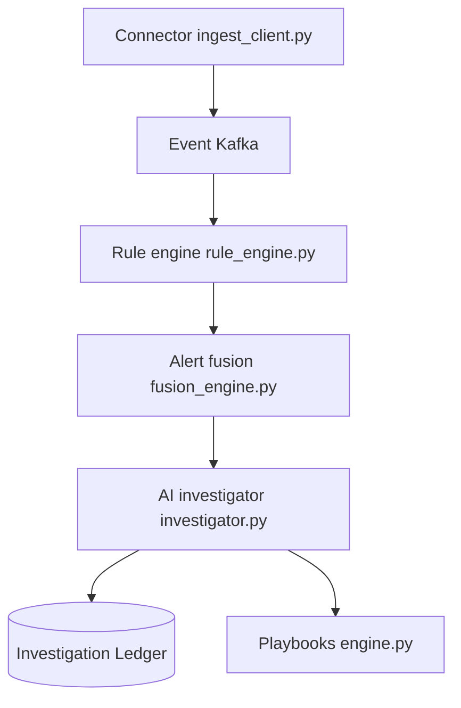

# beenuar/AiSOC

> SOC de sécurité auto-hébergé : ingère la télémétrie, détecte, fait enquêter des agents IA, un humain valide.

## Le problème
Les équipes sécurité noient sous les alertes et enquêtent à la main, sans trace vérifiable du raisonnement d'un assistant IA.

## Ce que ça fait vraiment
- Normalise la télémétrie, passe par Kafka, applique 2 538 règles exécutables (sur 7 023 en bibliothèque) et regroupe les alertes en incidents.
- Un agent IA enquête et consigne prompts et appels d'outils dans un registre d'enquête, exportable en bundle signé.
- Les actions de réponse (playbooks) restent en aperçu et exigent une approbation humaine.
- 90 connecteurs ; modèle local llama3.2:3b (~2 Go) fourni, aucun fournisseur hébergé testé selon le README.

## Comment c'est branché


## Essayer
```bash
git clone https://github.com/beenuar/AiSOC && cd AiSOC
make up
make smoke
pip install aisoc-sandbox && aisoc-sandbox demo
```

## Coût et pièges
Docker Compose v2 avec 8 Go de RAM et 20 Go de disque ; ~2 Go de modèle au premier lancement ; profil `full` : ~12 Go. Le modèle local 3B n'est pas un modèle de pointe.

## Ce que ce n'est pas
Pas un remplaçant de SIEM (pas de rétention longue). Ne voit rien de ce que tu n'as pas connecté. Les chiffres de benchmark mesurent la cohérence du système, pas la précision d'agents en production.

## Alternatives
Aucune alternative nommée dans le README.

## Pour toi
À surveiller : hors cœur data/MLOps, mais un bon exemple d'agents IA auditables ; un mainteneur unique pèse sur un outil de sécurité.

