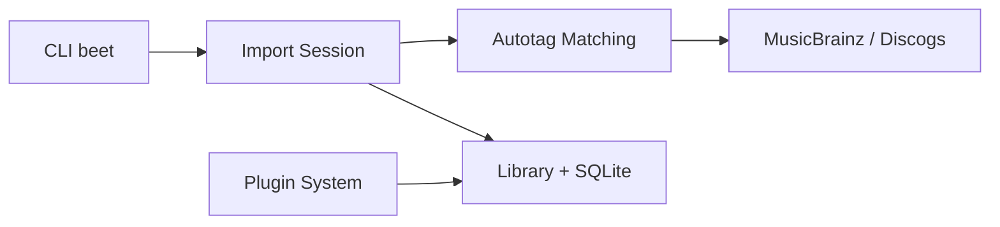

# beetbox/beets

> Music library manager that fixes metadata, for meticulous collectors.

## The problem
A collection of music files has wrong, incomplete or duplicate tags.

## What it actually does
`beet import` catalogs the files, suggests automatic corrections (MusicBrainz, Discogs, Beatport, acoustic fingerprints) then stores tags and records in a SQLite database. Plugins add cover art, lyrics, genres, ReplayGain, transcoding, duplicate detection, a web interface and MPD playback.

## How it is wired


## Trying it
```bash
pip install beets
beet import ~/music/ladytron
```

## Cost and gotchas
Free. The metadata sources are external services. 706 open issues: a lot.

## What it is not
It is not a player or a streaming service. Plugins are written in Python.

## Alternatives
No alternative named in the README.

## For you
Ignore it: a tool for a music collection, unrelated to data/AI work, despite its quality.
