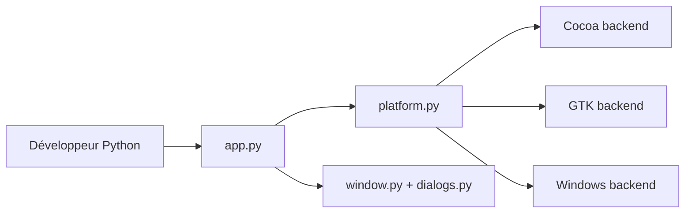

# beeware/toga

> Python toolkit for writing native graphical interfaces on every system.

## The problem
Writing a desktop or mobile application in Python with native widgets forces you to learn one API per platform.

## What it actually does
A common Python API (application, windows, widgets, commands and menus, dialogs, documents, screens, hardware, list/tree data sources) that picks a native backend depending on the platform: Cocoa, GTK, Qt, Windows, Android, iOS, Web, Textual. The README details almost nothing else; the documentation is on Read The Docs.

## How it is wired


## Trying it
```bash
pip install toga-demo
toga-demo
```

## Cost and gotchas
Free. Each backend has its own prerequisites, referred to the platform documentation (not read here). 311 open issues.

## What it is not
Not a web framework nor a data dashboard tool: it targets native applications. The README is very terse.

## Alternatives
No alternative named in the README.

## For you
Keep an eye on it: an option for shipping a small internal tool as a native Python application; for dashboards, a web tool remains more suitable.
