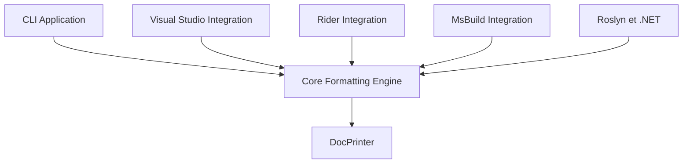

# belav/csharpier

> Opinionated C# and XML code formatter, inspired by Prettier.

## The problem
C# teams argue about style and lose time in reviews over formatting.

## What it actually does
CSharpier parses C# code with Roslyn and rewrites it according to its own rules, with deliberately few options. It runs from the command line, on save in the editor, as a pre-commit hook or in CI. Integrations exist for Visual Studio, Rider, VS Code and MSBuild.

## How it is wired


## Trying it
```bash
dotnet tool install -g csharpier
csharpier format .
```

## Cost and gotchas
Free. The .NET SDK is required, and is missing from the list of prerequisites. Options are limited by design.

## What it is not
It is not a quality analyzer or a linter: it only reformats. It does not handle languages other than C# and XML.

## Alternatives
No alternative named in the README (it cites Prettier as the source of the printing engine).

## For you
Ignore: only useful if you write C#; for Python or SQL, a formatter from your own ecosystem is enough.
