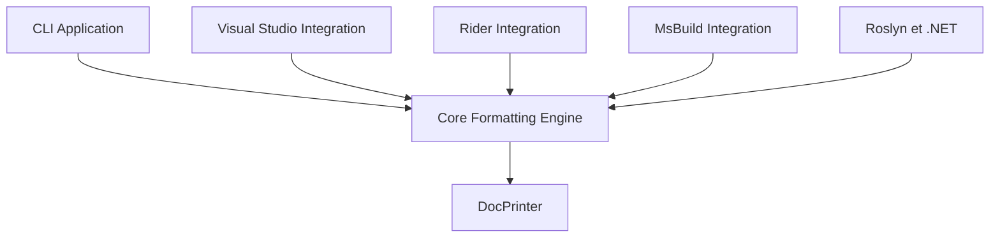

# belav/csharpier

> Formateur de code C# et XML à règles imposées, inspiré de Prettier.

## Le problème
Les équipes C# débattent du style et perdent du temps en revues sur la mise en forme.

## Ce que ça fait vraiment
CSharpier analyse le code C# avec Roslyn et le réécrit selon ses propres règles, avec peu d'options volontairement. Il se lance en ligne de commande, au moment de l'enregistrement dans l'éditeur, en hook de pré-commit ou en CI. Des intégrations existent pour Visual Studio, Rider, VS Code et MSBuild.

## Comment c'est branché


## Essayer
```bash
dotnet tool install -g csharpier
csharpier format .
```

## Coût et pièges
Gratuit. Il faut le SDK .NET, absent de la liste de prérequis. Les options sont limitées par choix.

## Ce que ce n'est pas
Ce n'est pas un analyseur de qualité ni un linter : il reformate seulement. Il ne gère pas d'autres langages que C# et XML.

## Alternatives
Aucune alternative nommée dans le README (il cite Prettier comme source du moteur d'impression).

## Pour toi
À ignorer : utile seulement si tu écris du C# ; pour du Python ou du SQL, un formateur de ton écosystème suffit.

