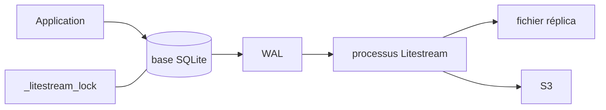

# benbjohnson/litestream

> Continuous replication of a SQLite database to a file or S3, for disaster recovery.

## The problem
A production SQLite database has no built-in incremental backup mechanism.
Copying the file while it is live risks capturing an inconsistent state during a WAL checkpoint.

## What it actually does
Litestream runs as a background process and replicates changes incrementally
to another file or to S3. It talks to SQLite only through the SQLite API, so it does not corrupt
the database. It creates an internal table `_litestream_lock` in the source database to acquire the
write lock during synchronization around WAL checkpoints; writes are done
in rolled-back transactions, so no row remains in it.

## How it is wired

## Trying it
No installation or usage command is documented in the README: it points to the Litestream
website for installation instructions and documentation.

## Cost and gotchas
Free. Creating `_litestream_lock` modifies the source database's schema and may change its
page count: the database does not stay byte-for-byte identical to its pre-Litestream state.
An S3 destination implies an account and a storage bill at your expense.

## What it is not
It is not a multi-master replication system or a SQLite cluster: it is disaster
recovery. Do not delete `_litestream_lock` while Litestream is running — synchronization
around a checkpoint may fail until reset. The table also shows up in
restored databases, since the source schema is backed up.

## Alternatives
No alternative is named in the README.

## For you
Useful if you host an app or an inference service backed by SQLite and want
continuous backup without setting up Postgres.
