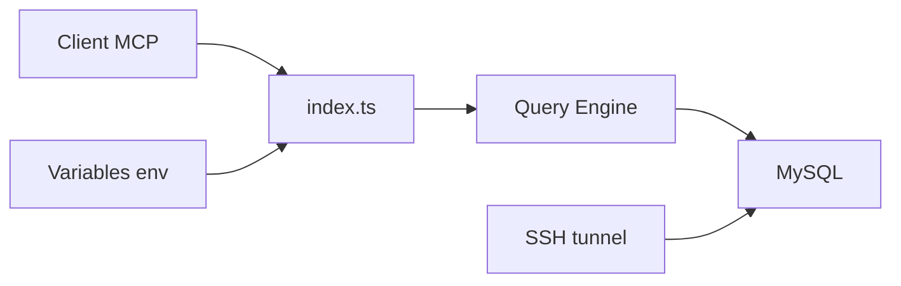

# benborla/mcp-server-mysql

> MCP server giving an AI assistant read-only access to a MySQL database.

## The problem
Letting an assistant query a MySQL database without risk of writes or leaking sensitive data.

## What it actually does
A `mysql_query` tool runs SQL, read-only by default; INSERT, UPDATE and DELETE are unlocked through environment variables. A `mysql://tables` resource lists tables and columns. It also offers multi-database mode, per-schema permissions, PII masking, SSH tunnel, SSL/TLS and a remote HTTP mode with token.

## How it is wired


## Trying it
```bash
claude mcp add mcp_server_mysql \
  -e MYSQL_HOST="127.0.0.1" \
  -e MYSQL_PORT="3306" \
  -e MYSQL_USER="root" \
  -e MYSQL_PASS="your_password" \
  -e MYSQL_DB="your_database" \
  -- npx @benborla29/mcp-server-mysql
```

## Cost and gotchas
Node 20+ and MySQL 5.7+. Use a MySQL user with limited privileges: the README example uses `root`. Enabling writes increases the risk.

## What it is not
Not a full SQL client nor a security guarantee: protection relies on the flags and the account's rights.

## Alternatives
- No alternative named in the README.

## For you
Adopt if you query MySQL from Claude: read-only by default and PII can be masked; create a dedicated account.
