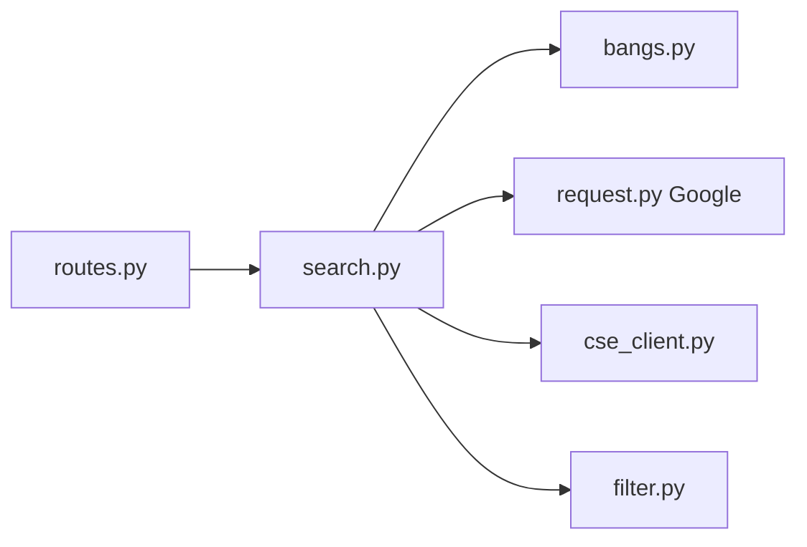

# benbusby/whoogle-search

> Google search proxy with no ads or tracking, shut down in July 2026 because Google blocked its approach.

## The problem
Getting Google results without ads, JavaScript or tracking of your IP address.

## What it actually does
Historically: a Flask application that queried Google without JavaScript, cleaned up the results, and handled bangs, themes, proxies and Tor. The README dated July 24, 2026 states that Whoogle no longer returns results: Google blocked the latest User-Agent strings, and the Custom Search (BYOK) route is no longer viable.

## How it is wired


## Trying it
```bash
docker pull benbusby/whoogle-search
docker run --publish 5000:5000 --detach --name whoogle-search benbusby/whoogle-search:latest
```
These commands will no longer produce results, according to the README.

## Cost and gotchas
Free, but unusable: no more commits, fixes or support. Repository archived.

## What it is not
Not a working solution today: the README asks you not to expect it to work.

## Alternatives
- Searx: the README encouraged it for other engines.
- Kagi: paid, cited as a replacement by users.

## For you
Ignore: archived and broken by Google's blocking, do not install it.
