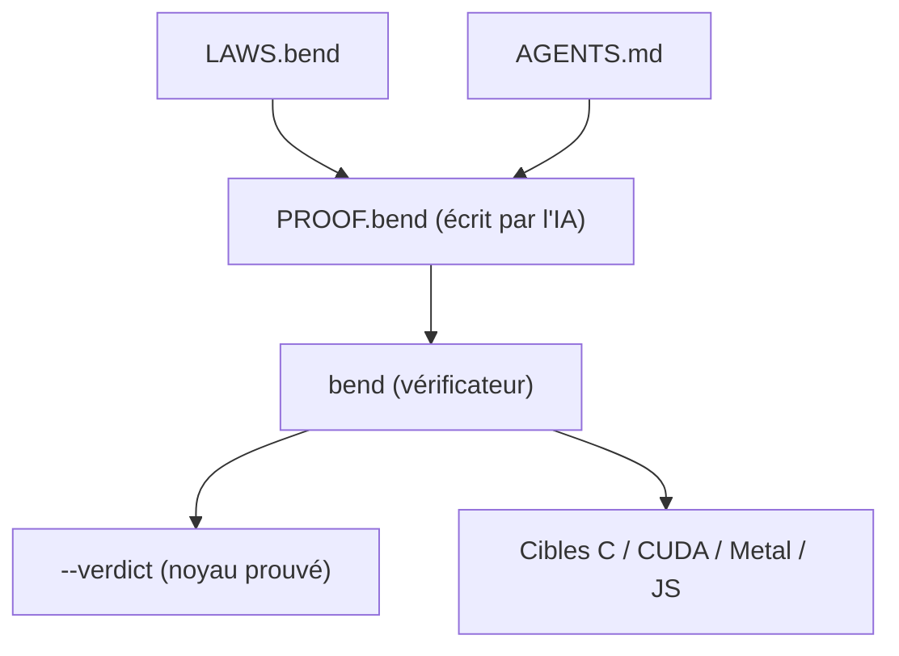

# bendlang/bend

> Dependently typed language with proofs, compiled to C, CUDA and Metal, for AI coding agents.

## The problem
Code written by an AI is not reviewed, and nothing guarantees that it respects the project's rules.

## What it actually does
README and identity identical to HigherOrderCO/Bend (same stars, same dates): same project, probably a redirected name. Python-syntax language with `LAWS.bend` and proofs checked by `bend PROOF.bend`, targets C, Metal, CUDA, JavaScript.

## How it is wired


## Trying it
```bash
curl -fsSL https://bend-lang.com/install.sh | sh
bend guide
bend PROOF.bend
```

## Cost and gotchas
Free. clang 14+, Metal or CUDA 12 for native. No native Windows.

## What it is not
Apparent duplicate of HigherOrderCO/Bend in the catalog: do not count it twice. Not compatible with Bend 1 / HVM.

## Alternatives
No alternative named in the README.

## For you
Watch, like HigherOrderCO/Bend of which it is the duplicate: appealing concept, ecosystem too thin to invest in.
