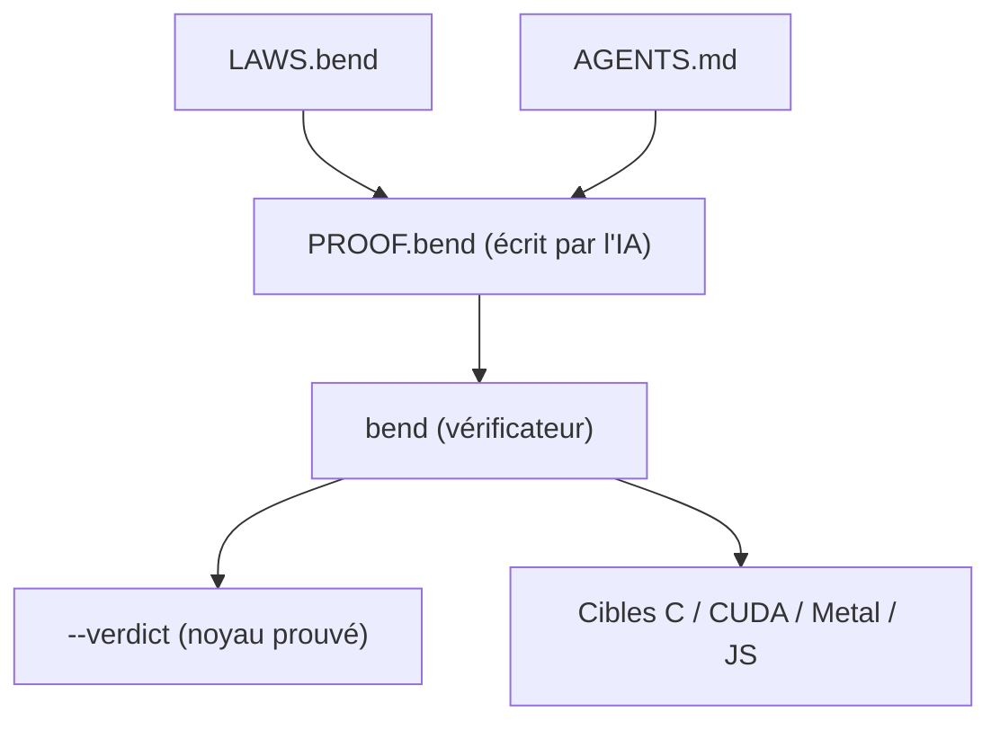

# bendlang/bend

> Langage à types dépendants et preuves, compilé vers C, CUDA et Metal, pour agents IA qui codent.

## Le problème
Un code écrit par une IA n'est pas relu, et rien ne garantit qu'il respecte les règles du projet.

## Ce que ça fait vraiment
README et identité identiques à HigherOrderCO/Bend (mêmes étoiles, mêmes dates) : même projet, sans doute un nom redirigé. Langage syntaxe Python avec `LAWS.bend` et preuves vérifiées par `bend PROOF.bend`, cibles C, Metal, CUDA, JavaScript.

## Comment c'est branché


## Essayer
```bash
curl -fsSL https://bend-lang.com/install.sh | sh
bend guide
bend PROOF.bend
```

## Coût et pièges
Gratuit. clang 14+, Metal ou CUDA 12 pour le natif. Pas de Windows natif.

## Ce que ce n'est pas
Doublon apparent de HigherOrderCO/Bend dans le catalogue : ne pas le compter deux fois. Pas compatible Bend 1 / HVM.

## Alternatives
Aucune alternative nommée dans le README.

## Pour toi
À surveiller, comme HigherOrderCO/Bend dont c'est le doublon : concept séduisant, écosystème trop mince pour y investir.

