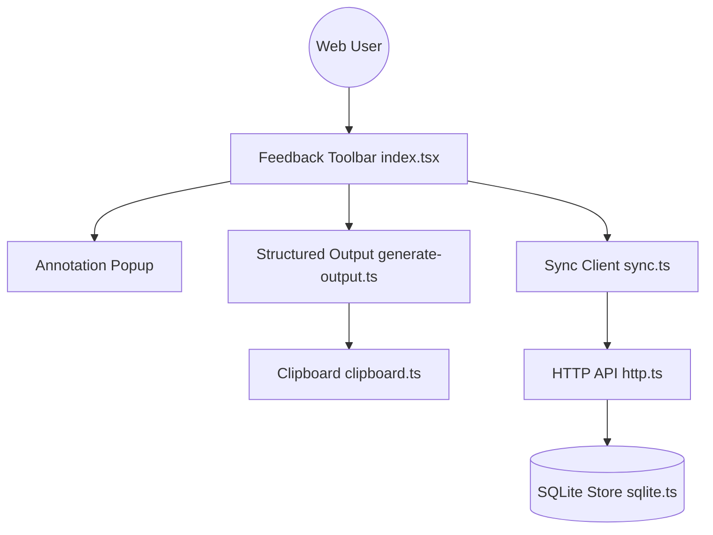

# benjitaylor/agentation

> React toolbar that turns clicks on your page into structured notes for a coding agent.

## The problem
Telling an agent "the blue button in the sidebar" is ambiguous: it does not know which file to modify.

## What it actually does
You add the `<Agentation />` component to your app. You click an element, write a note, and the tool copies markdown with selector, position and context. Direct sync goes through a local MCP server (`agentation-mcp`) with HTTP, SQLite and optional webhooks. Runtime dependencies: only React peers.

## How it is wired


## Trying it
```bash
npm install agentation -D
npx -y agentation-mcp server
```
```tsx
<Agentation endpoint="http://localhost:4747" />
```

## Cost and gotchas
Free, but React 18+ is required and desktop browser only (mobile not supported). License present but not identified by GitHub: to be read.

## What it is not
Not a testing or automatic visual review tool. Not an agent: it only prepares the feedback that the agent reads, by copy-paste or MCP.

## Alternatives
No alternative named in the README.

## For you
Worth watching: handy for a React front end driven by an agent, but of no interest for data or MLOps work outside a web interface.
