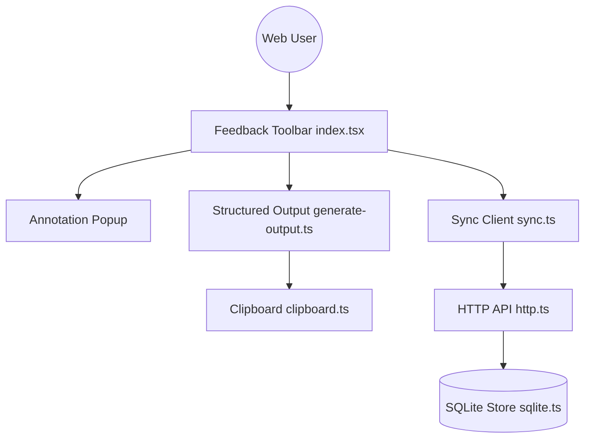

# benjitaylor/agentation

> Barre d'outils React qui transforme des clics sur ta page en notes structurées pour un agent de code.

## Le problème
Dire à un agent « le bouton bleu dans la barre latérale » est ambigu : il ne sait pas quel fichier modifier.

## Ce que ça fait vraiment
Tu ajoutes le composant `<Agentation />` à ton app. Tu cliques sur un élément, tu écris une note, et l'outil copie du markdown avec sélecteur, position et contexte. Une synchro directe passe par un serveur MCP local (`agentation-mcp`) avec HTTP, SQLite et webhooks optionnels. Dépendances d'exécution : seulement les pairs React.

## Comment c'est branché


## Essayer
```bash
npm install agentation -D
npx -y agentation-mcp server
```
```tsx
<Agentation endpoint="http://localhost:4747" />
```

## Coût et pièges
Gratuit, mais React 18+ obligatoire et navigateur de bureau uniquement (mobile non supporté). Licence présente mais non identifiée par GitHub : à lire.

## Ce que ce n'est pas
Ce n'est pas un outil de test ni de revue visuelle automatique. Ce n'est pas un agent : il prépare seulement le retour que l'agent lit, par copier-coller ou MCP.

## Alternatives
Aucune alternative nommée dans le README.

## Pour toi
À surveiller : pratique pour un front React piloté par un agent, mais sans intérêt pour un travail data ou MLOps hors interface web.

