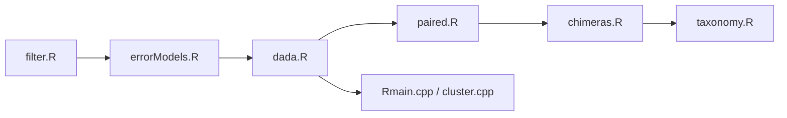

# benjjneb/dada2

> R package that infers exact sequence variants from amplicon reads.

## The problem
Telling true sequenced variants apart from error, down to a single nucleotide of difference.

## What it actually does
Pipeline: read filtering, error learning, variant inference, paired-read merging, sequence table, chimera removal, taxonomic assignment. Computation core in C++. Distributed via Bioconductor, with a tutorial for Illumina MiSeq data.

## How it is wired

## Trying it
No complete command in the README (the installation block is truncated): install through Bioconductor, tutorial on the website.

## Cost and gotchas
Free, LGPL-3.0 license. 227 open issues. Requires R and Bioconductor, and sequencing data (Illumina amplicons); computation needs memory on large datasets.

## What it is not
Not a sequencing tool; it processes raw reads that have already been produced.

## Alternatives
No alternative named in the README (OTUs are cited as the approach replaced, in a publication).

## For you
Worth watching: the metabarcoding reference in R, of no value outside microbiome work.
