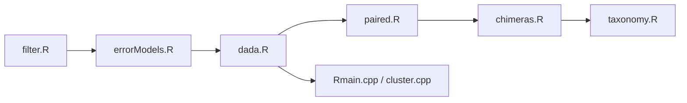

# benjjneb/dada2

> Paquet R qui infère des variants de séquences exacts à partir de lectures d'amplicons.

## Le problème
Distinguer de vraies variantes séquencées de l'erreur, jusqu'à un nucléotide d'écart.

## Ce que ça fait vraiment
Pipeline : filtrage des lectures, apprentissage des erreurs, inférence de variants, fusion des paires, table de séquences, suppression des chimères, attribution taxonomique. Cœur de calcul en C++. Distribué via Bioconductor, avec tutoriel pour données Illumina MiSeq.

## Comment c'est branché

## Essayer
Aucune commande complète dans le README (le bloc d'installation est tronqué) : installation par Bioconductor, tutoriel sur le site.

## Coût et pièges
Gratuit, licence LGPL-3.0. 227 issues ouvertes. Prévoir R et Bioconductor, et des données de séquençage (amplicons Illumina) ; le calcul demande de la mémoire sur de gros jeux de données.

## Ce que ce n'est pas
Pas un outil de séquençage ; il traite des lectures brutes déjà produites.

## Alternatives
Aucune alternative nommée dans le README (OTU cités comme approche remplacée dans une publication).

## Pour toi
À surveiller : référence du métabarcoding en R, sans valeur hors microbiome.

