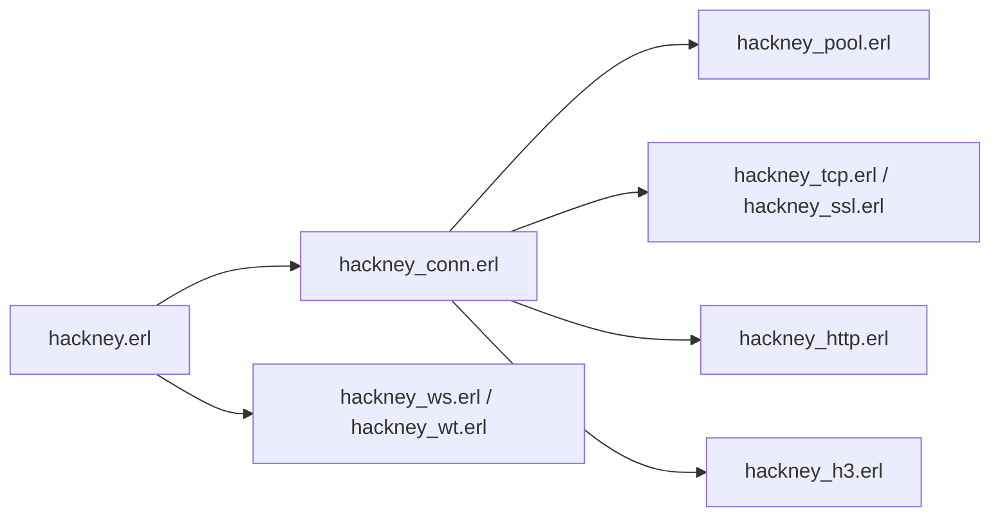

# benoitc/hackney

> HTTP client for Erlang and Elixir, with HTTP/2, experimental HTTP/3, WebSocket and WebTransport.

## The problem
Erlang/Elixir applications need an HTTP client with connection pooling and modern protocols.

## What it actually does
One connection per `gen_statem` process, pooling, body streaming, asynchronous responses via messages, HTTP/2 negotiated through ALPN, HTTP/3 (QUIC) on request, WebSocket and WebTransport, IPv6 Happy Eyeballs, SSL enabled by default with the Mozilla CA bundle, automatic decompression. Requires Erlang/OTP 27+.

## How it is wired


## Trying it
```erlang
application:ensure_all_started(hackney).
{ok, 200, _Headers, Body} = hackney:get(<<"https://httpbin.org/get">>).
```
```bash
# rebar3 : {deps, [hackney]}.   Mix : {:hackney, "~> 4.0"}
```

## Cost and gotchas
Free. HTTP/3 goes over UDP, which is sometimes blocked; the pool does not keep HTTPS connections by default (`ssl_pooling`).

## What it is not
Not an HTTP server nor a client for Python: Erlang/Elixir only.

## Alternatives
No alternative named in the README.

## For you
Ignore: Erlang/Elixir library, outside your data/AI/MLOps stack.
