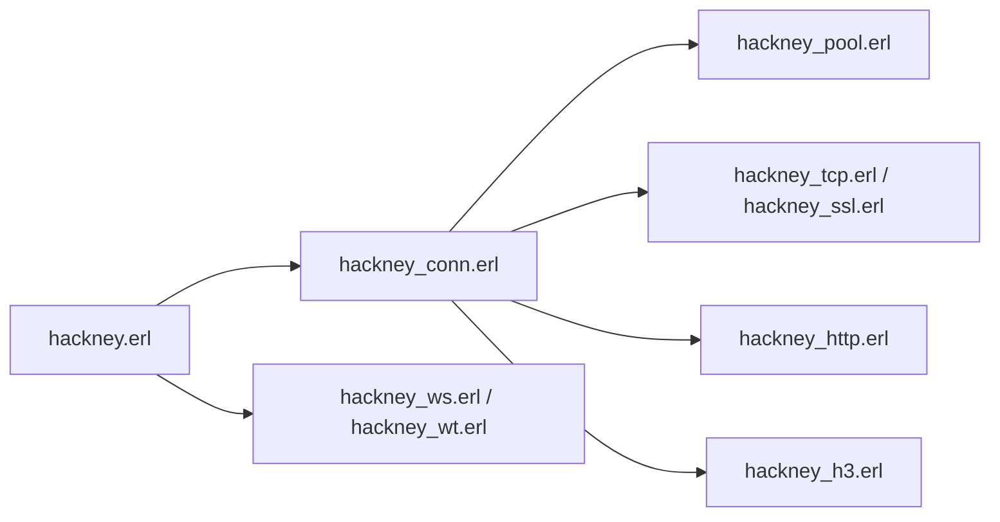

# benoitc/hackney

> Client HTTP pour Erlang et Elixir, avec HTTP/2, HTTP/3 expérimental, WebSocket et WebTransport.

## Le problème
Les applications Erlang/Elixir ont besoin d'un client HTTP avec pool de connexions et protocoles modernes.

## Ce que ça fait vraiment
Une connexion par processus `gen_statem`, pooling, streaming des corps, réponses asynchrones par messages, HTTP/2 négocié par ALPN, HTTP/3 (QUIC) sur demande, WebSocket et WebTransport, Happy Eyeballs IPv6, SSL activé par défaut avec le bundle de CA Mozilla, décompression automatique. Nécessite Erlang/OTP 27+.

## Comment c'est branché


## Essayer
```erlang
application:ensure_all_started(hackney).
{ok, 200, _Headers, Body} = hackney:get(<<"https://httpbin.org/get">>).
```
```bash
# rebar3 : {deps, [hackney]}.   Mix : {:hackney, "~> 4.0"}
```

## Coût et pièges
Gratuit. HTTP/3 passe par UDP, parfois bloqué ; le pool ne garde pas les connexions HTTPS par défaut (`ssl_pooling`).

## Ce que ce n'est pas
Pas un serveur HTTP ni un client pour Python : Erlang/Elixir seulement.

## Alternatives
Aucune alternative nommée dans le README.

## Pour toi
À ignorer : bibliothèque Erlang/Elixir, hors de ta pile data/IA/MLOps.

