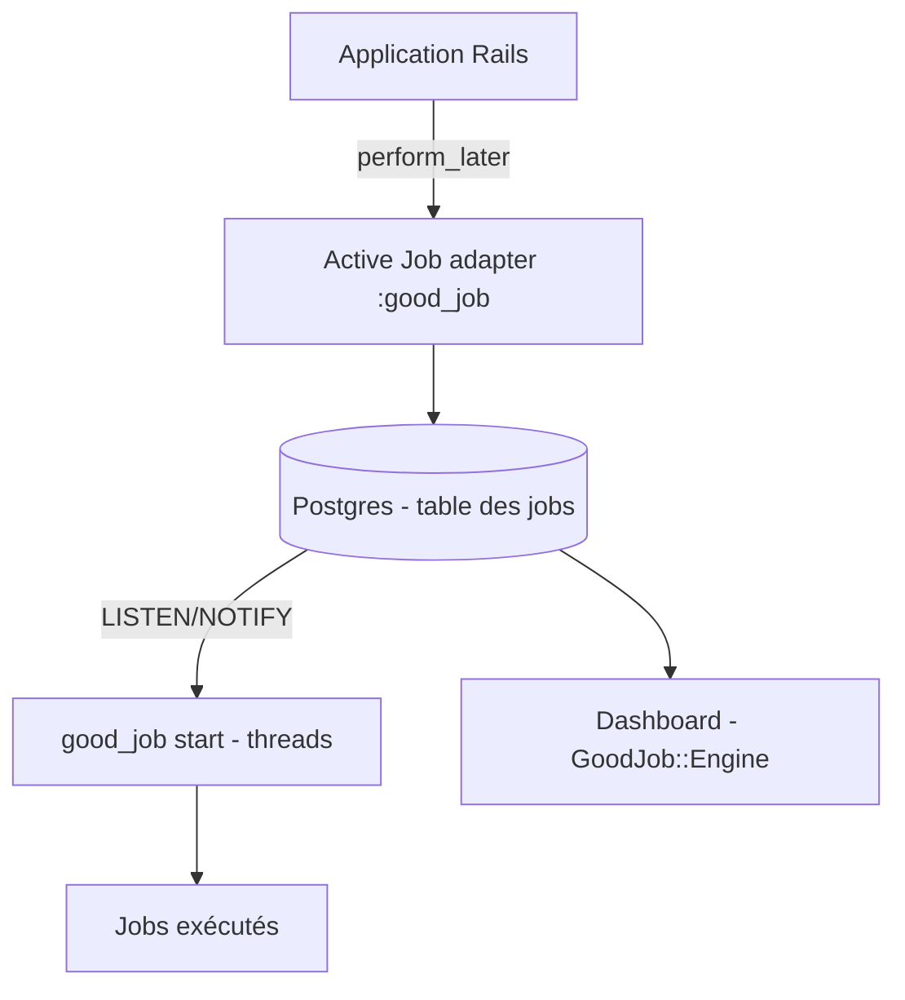

# bensheldon/good_job

> Multithreaded Active Job queue gem for Ruby on Rails that stores everything in Postgres.

## The problem
Rails job queues often require Redis or an extra service, with a risk of losing jobs on a crash.

## What it actually does
GoodJob records jobs in a Postgres table and uses advisory locks to guarantee single execution, and LISTEN/NOTIFY to reduce latency. It handles queues, priorities, delays, retries, cron, batches, concurrency limits and a dashboard mounted as a Rails engine. It runs inside the web process (`async`) or in a separate process via `good_job start` (`external`).

## How it is wired
Simplified diagram based on the fiche, no diagram provided.



## Trying it
```bash
bundle add good_job
bin/rails g good_job:install
bin/rails db:migrate
bundle exec good_job start
```
Then `config.active_job.queue_adapter = :good_job`.

## Cost and gotchas
Free. Requires Postgres 10+, Rails 6.1+ and Ruby 3.0+. The dashboard exposes job data: protect access with authentication. `preserve_job_records` is true by default: the table grows without cleanup.

## What it is not
It is not a Python tool nor a data pipeline orchestrator: only a job backend for Rails. It does not replace Redis for volumes beyond what Postgres can handle.

## Alternatives
- Solid Queue: multi-database, but periodic polling rather than LISTEN/NOTIFY.
- Sidekiq: relies on Redis; the Pro version avoids job loss.
- Que, Delayed Job: same Postgres family.

## For you
Ignore: reserved for Ruby on Rails applications, no use for a data, AI or MLOps profile working in Python.
