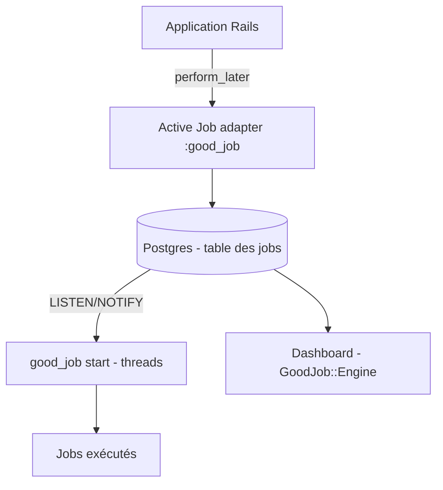

# bensheldon/good_job

> Gem Ruby on Rails de file de tâches Active Job multithread qui stocke tout dans Postgres.

## Le problème
Les files de tâches Rails demandent souvent Redis ou un service en plus, avec des risques de perte de jobs en cas de crash.

## Ce que ça fait vraiment
GoodJob enregistre les jobs dans une table Postgres et utilise les verrous consultatifs pour garantir l'exécution unique, et LISTEN/NOTIFY pour réduire la latence. Il gère files, priorités, délais, réessais, cron, lots, limites de concurrence et un tableau de bord monté comme moteur Rails. Il s'exécute dans le processus web (`async`) ou dans un processus séparé via `good_job start` (`external`).

## Comment c'est branché
Schéma simplifié d'après la fiche, sans diagramme fourni.



## Essayer
```bash
bundle add good_job
bin/rails g good_job:install
bin/rails db:migrate
bundle exec good_job start
```
Puis `config.active_job.queue_adapter = :good_job`.

## Coût et pièges
Gratuit. Il faut Postgres 10+, Rails 6.1+ et Ruby 3.0+. Le tableau de bord expose des données de jobs : protéger l'accès par authentification. `preserve_job_records` est vrai par défaut : la table grossit sans nettoyage.

## Ce que ce n'est pas
Ce n'est pas un outil Python ni un orchestrateur de pipelines de données : seulement un backend de jobs pour Rails. Il ne remplace pas Redis pour des volumes dépassant ce que Postgres encaisse.

## Alternatives
- Solid Queue : multi-bases, mais interrogation périodique plutôt que LISTEN/NOTIFY.
- Sidekiq : s'appuie sur Redis ; la version Pro évite la perte de jobs.
- Que, Delayed Job : même famille Postgres.

## Pour toi
À ignorer : réservé aux applications Ruby on Rails, sans usage pour un profil data, IA ou MLOps travaillant en Python.

