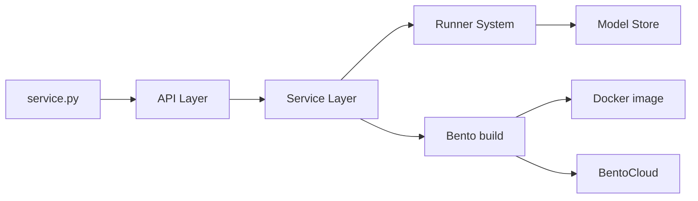

# bentoml/BentoML

> Python library for turning an inference script into a served, containerized API.

## The problem
Going from a model script to a robust HTTP service means handling dependencies, batching, GPUs, versions and a Docker image.

## What it actually does
You declare a `@bentoml.service` class (Python image, packages) and typed `@bentoml.api` methods, optionally `batchable`. `bentoml serve` starts the local server, `bentoml build` creates a "Bento" (code, models, dependencies), `bentoml containerize` produces the Docker image. Advanced features: multi-model composition, adaptive batching, workers, Model Store, observability. Optional deployment on BentoCloud.

## How it is wired

(Diagram supplied with no readable component: nodes taken from the explanation.)

## Trying it
```bash
pip install -U bentoml
bentoml serve
bentoml build
bentoml containerize summarization:latest
docker run --rm -p 3000:3000 summarization:latest
```

## Cost and gotchas
Free library; BentoCloud is paid. Anonymous usage collection is enabled by default, and can be disabled with `--do-not-track` or `BENTOML_DO_NOT_TRACK=True`.

## What it is not
Not a full MLOps platform (no experiment tracking) and not an optimized LLM inference engine: it wraps your own code.

## Alternatives
No alternative named in the README.

## For you
Adopt it for serving models in Python: typed API, batching and containerization in three commands, a long-established company project; just remember to turn off the telemetry.
