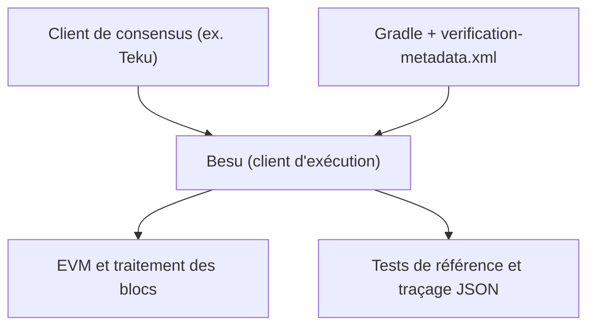

# besu-eth/besu

> Ethereum execution client in Java, Mainnet compatible, to be paired with a consensus client.

## The problem
Running an Ethereum node requires a maintained execution client tested against the reference tests.

## What it actually does
Besu is an Ethereum execution client under Apache 2.0. The README mostly serves as an entry point: documentation, Discord, contribution guide, Gradle dependency verification, profiling with Async Profiler and EVM JSON tracing for the reference tests.

## How it is wired
Simplified diagram based on the sheet, no diagram provided.


## Trying it
```bash
./gradlew --write-verification-metadata sha256 --refresh-dependencies --rerun-tasks --no-parallel updateVerificationMetadata
./gradlew verifySourceArtifacts
```

## Cost and gotchas
Free, but it needs an associated consensus client, a JVM and chain synchronization (disk space not stated in the README). Installation goes through the external documentation.

## What it is not
Not a full node on its own: the README specifies that a consensus client is required.

## Alternatives
Teku, cited in the README as a consensus client to pair with, not as a competitor.

## For you
Ignore: Java blockchain client, unrelated to a data / AI / MLOps profile.
