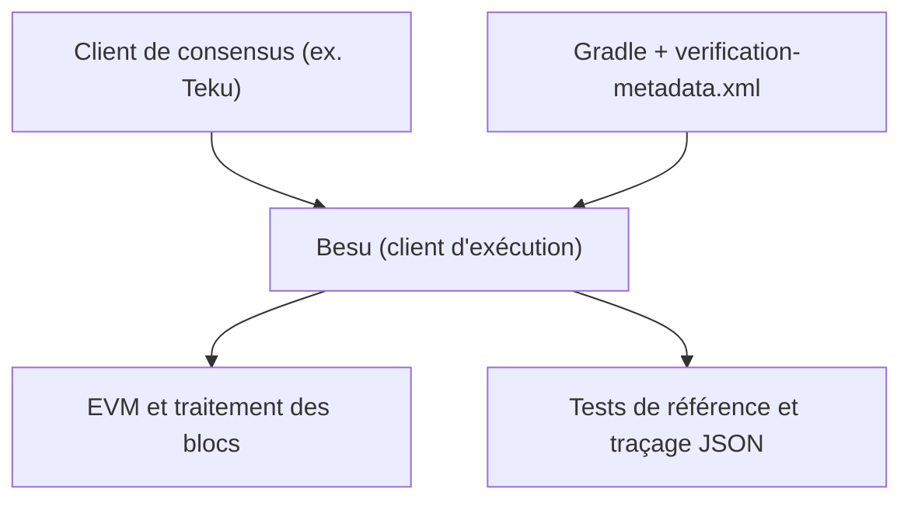

# besu-eth/besu

> Client d'exécution Ethereum en Java, compatible Mainnet, à associer à un client de consensus.

## Le problème
Faire tourner un nœud Ethereum exige un client d'exécution maintenu et testé contre les tests de référence.

## Ce que ça fait vraiment
Besu est un client d'exécution Ethereum sous Apache 2.0. Le README sert surtout de porte d'entrée : documentation, Discord, guide de contribution, vérification des dépendances Gradle, profilage avec Async Profiler et traçage JSON de l'EVM pour les tests de référence.

## Comment c'est branché
Schéma simplifié d'après la fiche, sans diagramme fourni.


## Essayer
```bash
./gradlew --write-verification-metadata sha256 --refresh-dependencies --rerun-tasks --no-parallel updateVerificationMetadata
./gradlew verifySourceArtifacts
```

## Coût et pièges
Gratuit, mais il faut un client de consensus associé, une JVM et la synchronisation de la chaîne (espace disque non chiffré dans le README). L'installation passe par la documentation externe.

## Ce que ce n'est pas
Pas un nœud complet à lui seul : le README précise qu'il faut un client de consensus.

## Alternatives
Teku, cité dans le README comme client de consensus à associer, et non comme concurrent.

## Pour toi
À ignorer : client de blockchain Java, sans rapport avec un profil data / IA / MLOps.

