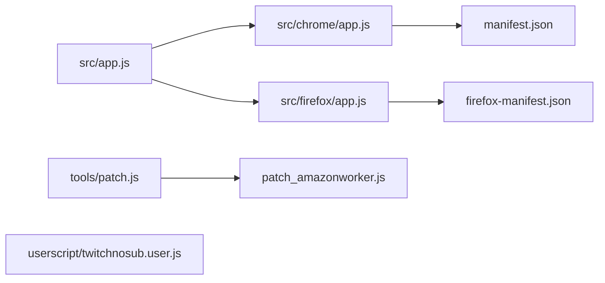

# besuper/TwitchNoSub

> Browser extension to watch subscriber-only Twitch rebroadcasts.

## The problem
Some Twitch rebroadcasts are reserved for subscribers; the extension aims to make them viewable without a subscription.

## What it actually does
According to the described code, shared logic (`src/app.js`) is adapted per browser: Chrome (`manifest.json`) and Firefox (`firefox-manifest.json`), plus an alternative userscript. A fix for the video worker (`patch_amazonworker.js`) and a `tools/patch.js` tool are involved. The README does not detail the mechanism.

## How it is wired


## Trying it
```bash
chromium --pack-extension=TwitchNoSub
```
For Chrome: developer mode then "Load unpacked extension". For Firefox: drag the `.xpi` file from the releases section.

## Cost and gotchas
Free. Manual installation in developer mode. The README notes the project is a work in progress. Depends on the Twitch site: any change on Twitch's side may break it.

## What it is not
It is not a data tool nor a stable product. It bypasses an access restriction of the service, which may violate its terms of use.

## Alternatives
No alternative named in the README.

## For you
Ignore: unrelated to data or AI, and it bypasses a service restriction.
