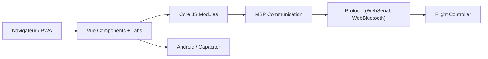

# betaflight/betaflight-configurator

> Configuration application for Betaflight flight controller firmware, for drone pilots.

## The problem
Tuning a flight controller (motors, failsafe, OSD) requires a dedicated tool that speaks its protocol.

## What it actually does
Progressive web application (PWA) built with Vue and Vite, which talks to the controller over MSP via Web Serial or Bluetooth. It also exists as Windows, Linux, macOS and Android (Capacitor) installers. It supports multiple languages.

## How it is wired


## Trying it
```bash
npm install
npm run dev
npm run build
npm run preview
npm test
```
Use the Node version indicated in `.nvmrc` (npm 11.6.1 or later).

## Cost and gotchas
Free. The test PWA version can corrupt the controller's settings. On Linux, add the user to the `dialout` group.

## What it is not
Not the firmware: that lives in the `betaflight/betaflight` repository. Not a flight simulator.

## Alternatives
No alternative named in the README.

## For you
Ignore: reserved for drone tuning, unrelated to your data/AI pipelines.
