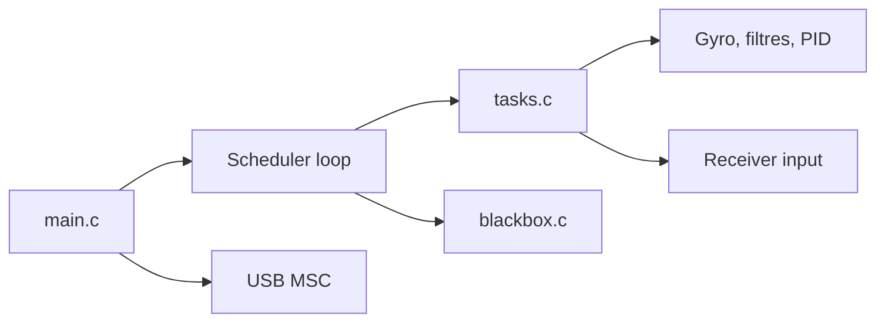

# betaflight/betaflight

> Open-source flight controller firmware for racing, freestyle and long-range drones.

## The problem
A drone needs precise, predictable flight, with open settings for any kind of hardware.

## What it actually does
Runs on the flight controller (STM32, AT32, RP2350, etc.): initializes the system then loops on the task scheduler (gyroscope, filters, PID, receiver). Handles OSD, RGB LEDs, blackbox, telemetry, DShot motor protocols, in-flight tuning; USB mass-storage mode for flash or SD card. Configuration through the Betaflight app (PWA).

## How it is wired


## Trying it
```bash
docker build -t betaflight-dev -f .devcontainer/containerfile .devcontainer/
docker run --rm -v "${PWD}:/workspace" -w /workspace betaflight-dev make TARGET=SPEEDYBEEF405WING
```

## Cost and gotchas
Free; compatible hardware is required. Hardware support is the manufacturer's responsibility, not the project's.

## What it is not
Not PC software: it is embedded firmware. Does not sell or manufacture hardware.

## Alternatives
No alternative named in the README.

## For you
Outside the data/AI scope: ignore unless you do FPV.
