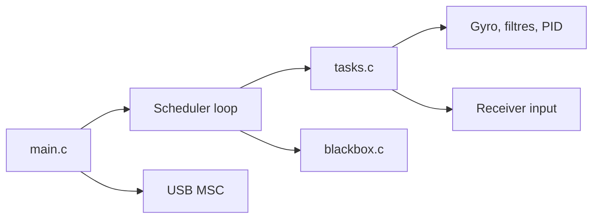

# betaflight/betaflight

> Firmware libre de contrôleur de vol pour drones de course, freestyle et longue portée.

## Le problème
Un drone a besoin d'un vol précis et prévisible, avec des réglages ouverts pour tout type de matériel.

## Ce que ça fait vraiment
Tourne sur le contrôleur de vol (STM32, AT32, RP2350, etc.) : initialise le système puis boucle sur l'ordonnanceur de tâches (gyroscope, filtres, PID, récepteur). Gère OSD, LED RGB, blackbox, télémétrie, protocoles moteur DShot, réglage en vol ; mode USB stockage pour flash ou carte SD. Configuration par l'appli Betaflight (PWA).

## Comment c'est branché


## Essayer
```bash
docker build -t betaflight-dev -f .devcontainer/containerfile .devcontainer/
docker run --rm -v "${PWD}:/workspace" -w /workspace betaflight-dev make TARGET=SPEEDYBEEF405WING
```

## Coût et pièges
Gratuit ; du matériel compatible est requis. Le support matériel revient au fabricant, pas au projet.

## Ce que ce n'est pas
Pas un logiciel pour PC : c'est un firmware embarqué. Ne vend ni ne fabrique de matériel.

## Alternatives
Aucune alternative nommée dans le README.

## Pour toi
Hors périmètre data/IA : à ignorer sauf si tu fais du FPV.

