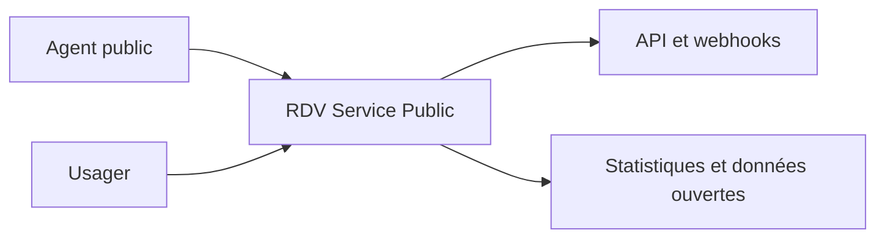

# betagouv/rdv-service-public

> Digital public service for appointment booking for French administrations and local authorities.

## The problem
Administrations handle appointment booking with citizens poorly, often by phone or with scattered tools.

## What it actually does
Appointment management and booking application run by DINUM and the ANCT's incubateur des territoires. Two main instances (RDV Solidarités and RDV Service Public) and a demo. Offers an API, notification webhooks, public statistics and open data.

## How it is wired
Simplified diagram based on the sheet, no diagram provided.



## Trying it
```bash
# Aucune commande documentée : le README renvoie à docs/0-docs.md pour le développement.
```

## Cost and gotchas
Service free for public organizations through the official instances. AGPL-3.0 license if you host it while modifying the code. 288 open issues.

## What it is not
Not a tool for individuals or the private sector: it targets public organizations.

## Alternatives
No alternative named in the README.

## For you
Ignore: French administrative service, outside data/AI/MLOps.
