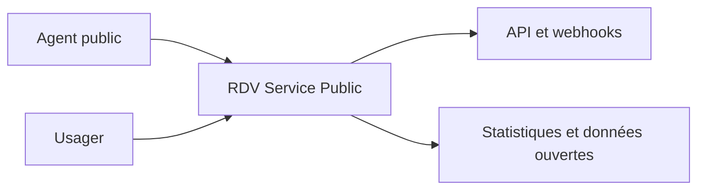

# betagouv/rdv-service-public

> Service public numérique de prise de rendez-vous pour administrations et collectivités françaises.

## Le problème
Les administrations gèrent mal la prise de rendez-vous avec les usagers, souvent par téléphone ou avec des outils dispersés.

## Ce que ça fait vraiment
Application de gestion et de prise de rendez-vous portée par la DINUM et l'incubateur des territoires de l'ANCT. Deux instances principales (RDV Solidarités et RDV Service Public) et une démo. Offre une API, des webhooks de notification, des statistiques publiques et des données ouvertes.

## Comment c'est branché
Schéma simplifié d'après la fiche, sans diagramme fourni.



## Essayer
```bash
# Aucune commande documentée : le README renvoie à docs/0-docs.md pour le développement.
```

## Coût et pièges
Service gratuit pour les organisations publiques via les instances officielles. Licence AGPL-3.0 si tu l'héberges en modifiant le code. 288 issues ouvertes.

## Ce que ce n'est pas
Pas un outil pour particuliers ni pour le privé : il cible les organisations publiques.

## Alternatives
Aucune alternative nommée dans le README.

## Pour toi
À ignorer : service administratif français, hors data/IA/MLOps.

