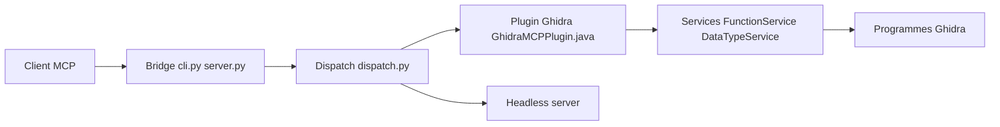

# bethington/ghidra-mcp

> MCP server exposing 209 Ghidra tools to an AI for binary reverse engineering.

## The problem
A binary analyst renames, types and comments thousands of functions by hand in Ghidra, with no consistency of conventions.

## What it actually does
A Ghidra extension (Java) opens a local HTTP service (port 8089); a Python bridge (`bridge-mcp-ghidra`) translates MCP into HTTP calls. Tools: decompilation, call graphs, xrefs, types, comments, P-code emulation, TraceRmi debugger, documentation transfer between versions. Lazy loading of tool groups. Headless mode and Docker.

## How it is wired


## Trying it
```bash
uv tool install https://github.com/bethington/ghidra-mcp/releases/download/v7.0.0/ghidra_mcp_bridge-7.0.0-py3-none-any.whl
curl http://127.0.0.1:8089/check_connection
```

## Cost and gotchas
Exactly Ghidra 12.1.4, Java 21, uv. Listens on loopback without authentication by default; binding externally requires a token. Script execution is disabled by default.

## What it is not
Not a complete automated malware analysis. Derived from LaurieWired/GhidraMCP. "Production-ready" is a self-declaration.

## Alternatives
- LaurieWired/GhidraMCP: the original project, more limited.

## For you
Worth watching only if you do reverse engineering; outside that scope, of no interest for data/MLOps.
