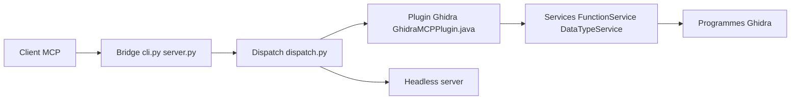

# bethington/ghidra-mcp

> Serveur MCP exposant 209 outils Ghidra à une IA pour l'ingénierie inverse de binaires.

## Le problème
Un analyste de binaires renomme, type et commente des milliers de fonctions à la main dans Ghidra, sans cohérence de conventions.

## Ce que ça fait vraiment
Une extension Ghidra (Java) ouvre un service HTTP local (port 8089) ; un pont Python (`bridge-mcp-ghidra`) traduit MCP en appels HTTP. Outils : décompilation, graphes d'appels, xrefs, types, commentaires, émulation P-code, débogueur TraceRmi, transfert de documentation entre versions. Chargement paresseux des groupes d'outils. Mode headless et Docker.

## Comment c'est branché


## Essayer
```bash
uv tool install https://github.com/bethington/ghidra-mcp/releases/download/v7.0.0/ghidra_mcp_bridge-7.0.0-py3-none-any.whl
curl http://127.0.0.1:8089/check_connection
```

## Coût et pièges
Ghidra 12.1.4 exact, Java 21, uv. Écoute en loopback sans authentification par défaut ; la bind externe exige un jeton. Exécution de scripts désactivée par défaut.

## Ce que ce n'est pas
Pas une analyse automatique de malware complète. Dérivé de LaurieWired/GhidraMCP. « Production-ready » est une auto-déclaration.

## Alternatives
- LaurieWired/GhidraMCP : projet d'origine, plus limité.

## Pour toi
À surveiller seulement si tu fais de l'ingénierie inverse ; hors de ce cadre, sans intérêt pour data/MLOps.

