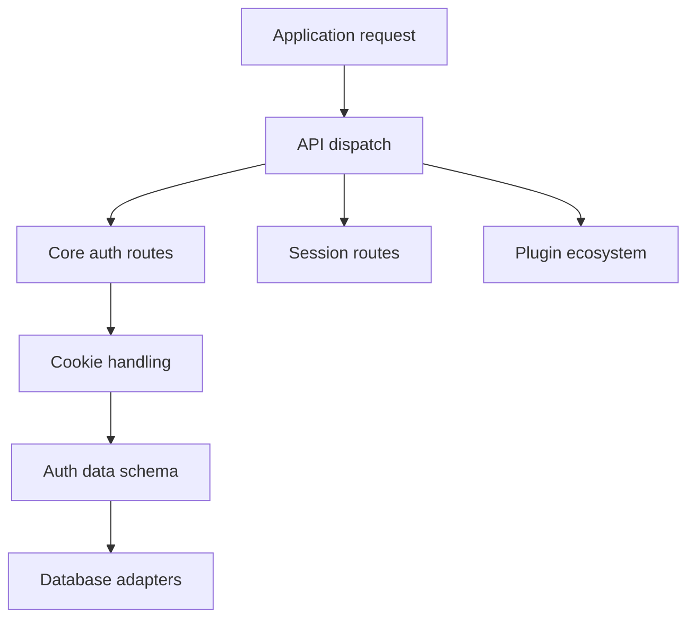

# better-auth/better-auth

> TypeScript authentication and authorization framework with plugins, for web application developers.

## The problem
In TypeScript, authentication beyond the basic case requires a lot of homegrown code or a third-party service.

## What it actually does
Receives a request, dispatches it to authentication routes (login, session), manages session cookies and returns the response. Plugins add OAuth and social providers, email OTP, passkeys, SAML SSO, device flows, administration, organizations and 2FA. Database adapters, secondary Redis storage and client SDKs (Next.js among others) complete the set.

## How it is wired

## Trying it
No documented command: the README contains neither installation nor example.

## Cost and gotchas
Free (MIT license). The README does not say which database or which settings are required: not documented here, to be read in the project documentation. Nearly a thousand open issues.

## What it is not
It is not a hosted service, but a library that you deploy and secure yourself. It is not a Python tool. The README alone does not allow evaluating security.

## Alternatives
No alternative named in the README.

## For you
Worth watching: relevant only if you are building a TypeScript web application with user accounts; outside that case, no data or MLOps interest.
