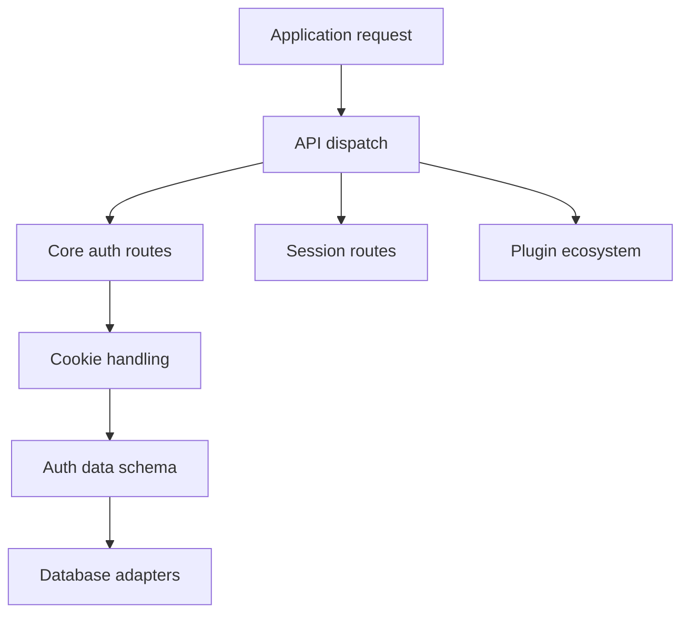

# better-auth/better-auth

> Framework TypeScript d'authentification et d'autorisation avec plugins, pour développeurs d'applications web.

## Le problème
En TypeScript, l'authentification au-delà du cas de base demande beaucoup de code maison ou un service tiers.

## Ce que ça fait vraiment
Reçoit une requête, la dispatche vers des routes d'authentification (connexion, session), gère les cookies de session et renvoie la réponse. Des plugins ajoutent OAuth et fournisseurs sociaux, OTP par e-mail, passkeys, SAML SSO, flux d'appareil, administration, organisations et 2FA. Des adaptateurs de base de données, un stockage Redis secondaire et des SDK clients (Next.js entre autres) complètent l'ensemble.

## Comment c'est branché

## Essayer
Aucune commande documentée dans le README, qui ne contient ni installation ni exemple.

## Coût et pièges
Gratuit (licence MIT). Le README ne dit pas quelle base de données ni quels paramètres sont nécessaires : non documenté ici, à lire dans la documentation du projet. Près d'un millier d'issues ouvertes.

## Ce que ce n'est pas
Ce n'est pas un service hébergé, mais une bibliothèque que tu déploies et sécurises toi-même. Ce n'est pas un outil Python. Le README seul ne permet pas d'évaluer la sécurité.

## Alternatives
Aucune alternative nommée dans le README.

## Pour toi
À surveiller : pertinent seulement si tu construis une application web TypeScript avec comptes utilisateurs ; hors de ce cas, aucun intérêt data ou MLOps.

